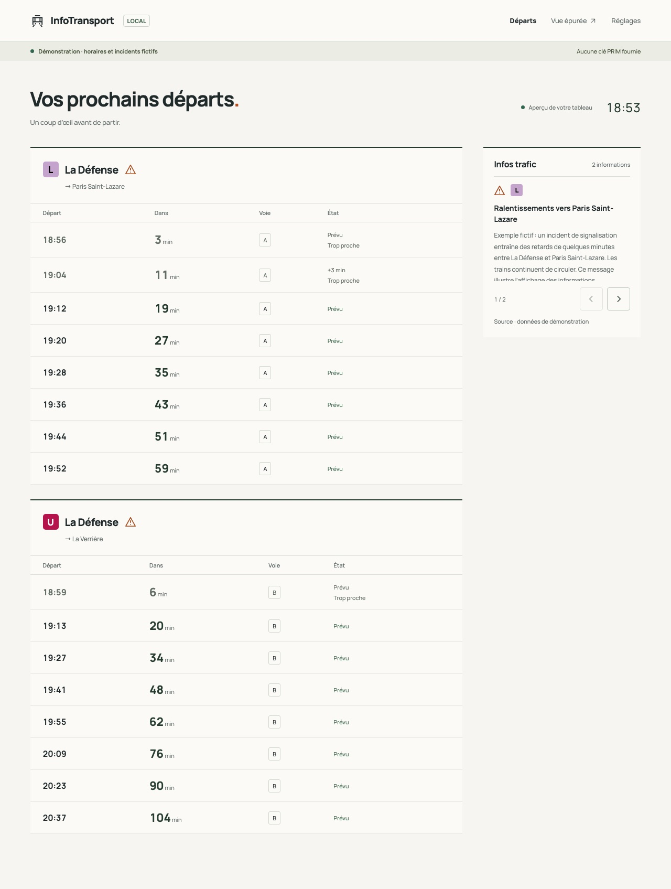
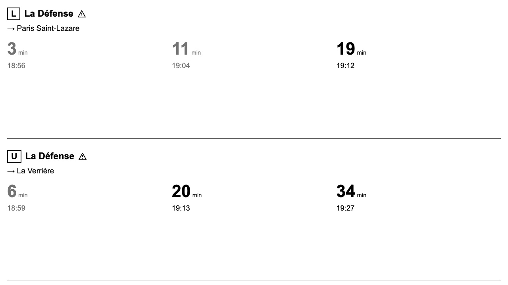
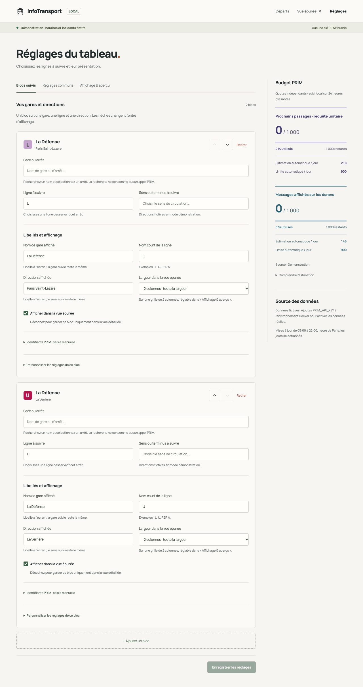

# InfoTransport

**Vos prochains transports et les perturbations de vos lignes, visibles d’un coup d’œil avant de partir.**

InfoTransport est un tableau de départs personnel, en français, à héberger chez soi et à consulter sur son réseau local. Il rassemble les prochains passages des transports que vous choisissez en Île-de-France et les informations trafic associées, à partir de PRIM, la plateforme de données d’Île-de-France Mobilités.

Par exemple, vous pouvez suivre la ligne L de La Défense vers Paris Saint-Lazare et la ligne U vers La Verrière sur un même écran. Vous voyez les temps d’attente, les heures de départ et les retards ou suppressions annoncés. En indiquant votre temps de trajet jusqu’à la gare, les départs trop proches sont atténués dans la vue détaillée et masqués dans la vue épurée, pour repérer plus facilement ceux que vous pouvez rejoindre.

## Ce que permet le projet

- **Suivre vos trajets habituels** : chaque bloc affiche une gare ou un arrêt, une ligne et une direction, avec une disposition et des réglages personnalisables.
- **Consulter les perturbations** : la vue détaillée présente les messages disponibles pour les lignes suivies ; la vue épurée les signale par une icône.
- **Garder un écran de départs à la maison** : une vue monochrome sans interaction est prévue notamment pour les petits écrans à encre électronique. La compatibilité et la lisibilité restent à vérifier sur votre appareil.
- **Tout régler depuis le navigateur** : rechercher les arrêts, choisir les lignes et directions, organiser les blocs et définir les horaires de fonctionnement.
- **Maîtriser les appels aux données** : le serveur partage son cache entre les vues, suspend la collecte hors des plages actives et suit les budgets PRIM.
- **Essayer sans clé API** : le mode démonstration fournit des horaires et incidents fictifs pour découvrir l’interface.

L’application est conçue pour un usage sur un réseau local de confiance, sans authentification intégrée. Elle fonctionne avec Node.js ou Docker, et conserve ses réglages dans des fichiers, sans base de données à installer.

## Aperçu du site

Ces captures montrent l’application en **mode démonstration** : les horaires et les incidents sont fictifs.

### Tableau des départs — `/`

La vue détaillée regroupe les prochains départs, les temps d’attente, les voies lorsqu’elles sont disponibles et les informations trafic.



### Vue épurée — `/minimal`

Une présentation monochrome limitée à l’essentiel : gare, ligne, direction, prochains départs et icône de perturbation. Elle affiche trois départs par bloc par défaut, sans défilement ni interaction, avec un HTML rendu côté serveur.



### Réglages — `/admin`

L’administration permet de choisir les transports suivis, d’ajuster l’affichage et les plages de collecte, et de consulter la consommation des budgets PRIM.



## Essayer en quelques minutes

1. Démarrer l’application avec Docker Compose ou en [développement](#développement), comme indiqué ci-dessous.
2. Sans clé `PRIM_API_KEY`, ouvrir la page d’accueil pour découvrir les deux blocs de démonstration pendant les plages actives (5 h–22 h par défaut, heure de Paris).
3. Explorer les réglages dans `/admin` et ouvrir `/minimal` pour voir la présentation destinée à un écran de consultation.
4. Pour suivre vos transports réels, ajouter une clé PRIM et [configurer vos arrêts, lignes et directions](#configurer-les-données-réelles).

## Démarrer avec Docker Compose

```sh
docker compose up -d --build
```

Ouvrir [localhost:3000](http://localhost:3000). Le volume `infotransport-data` conserve configuration, cache et compteurs après redémarrage.

**Sans `PRIM_API_KEY`, l'API locale renvoie automatiquement des données fictives et aucun appel PRIM n'est effectué.** Ce mode respecte également les plages actives, initialement 5 h–22 h en heure de Paris. Les données de démonstration sont signalées dans la vue riche et l'administration ; la vue épurée conserve son contenu minimal.

Pour activer les données réelles ou changer le port, définir les variables dans `.env` à côté du Compose :

```dotenv
PRIM_API_KEY=votre_cle_prim
PORT=4317
```

Puis recréer le conteneur :

```sh
docker compose up -d --force-recreate
```

Une clé non vide mais invalide ne bascule jamais silencieusement en démonstration : l'administration affiche les erreurs du fournisseur. Le serveur transmet le jeton à PRIM dans l'en-tête HTTP `apiKey`. La clé n'est ni enregistrée dans la configuration ni transmise au navigateur.

## Configurer les données réelles

La configuration initiale contient un profil « Principal » sans bloc. En mode démonstration (sans `PRIM_API_KEY`), deux profils sont fournis : **La Défense**, par défaut, avec **La Défense · L · Paris Saint-Lazare** et **La Défense · U · La Verrière**, et **Saint-Lazare**, avec **Paris Saint-Lazare · L · Versailles Rive Droite**. Leurs identifiants PRIM ne sont pas renseignés, car ils servent uniquement à illustrer l'interface.

1. Dans `/admin`, rechercher la gare et sélectionner le résultat.
2. Choisir la ligne et la direction parmi les passages disponibles, puis renseigner le nom court de ligne affiché si nécessaire.
3. Enregistrer les réglages. La collecte démarre à la prochaine échéance pendant une plage active.

La recherche de gares et de lignes utilise le référentiel local fourni (`resources/catalog.json`) : aucune requête PRIM, même hors plage ou sans clé. Les sens et terminus sont proposés à partir des passages SIRI Stop Monitoring, puis le trafic provient de SIRI General Message. La clé doit avoir accès à ces deux services. Les identifiants avancés peuvent aussi être renseignés manuellement : `MonitoringRef`, `LineRef`, et soit `DirectionRef`, soit `DestinationRef`. Pour le ferroviaire SNCF, utiliser une zone d'arrêt `STIF:StopArea:SP:…:` selon la documentation PRIM.

La découverte des directions dépend des départs effectivement annoncés. Le sens (`DirectionRef`) est prioritaire sur une destination précise, pour conserver les trains d'une même direction ayant des terminus différents. Les noms affichés ne servent pas de filtre réseau. Aucun horaire théorique n'est inventé si PRIM ne renvoie pas suffisamment de trains.

L'intégration réelle reste à vérifier avec une clé et les identifiants de vos arrêts ; les tests utilisent des réponses SIRI représentatives et un fournisseur simulé.

## Référentiel local et autocomplétion

Le fichier fourni `arrets-lignes.json` a été transformé en catalogue embarqué : 74 786 associations, 35 537 arrêts et 2 030 lignes. Les coordonnées et champs inutiles à la recherche sont écartés ; les communes, modes et opérateurs aident à distinguer les arrêts homonymes et les bus de remplacement.

La conversion respecte la granularité : `IDFM:monomodalStopPlace:470549` devient `STIF:StopArea:SP:470549:` ; un identifiant de quai numérique devient `STIF:StopPoint:Q:…:`. Les lignes `IDFM:C…` deviennent `STIF:Line::C…:`. Le catalogue ne contient pas de directions : aucun sens réel n’est déduit de l’ordre des arrêts. En démonstration, les sens portent des références `DEMO:` qui ne peuvent pas servir de filtre de collecte réelle.

Le référentiel évolue avec l’offre IDFM (nouvelles lignes, arrêts renommés). Le mettre à jour au moins chaque trimestre, ou dès qu’un arrêt manque dans la recherche ; la date d’import est affichée dans `/admin` (« Source des données »).

1. Télécharger depuis la plateforme open data IDFM le jeu « Arrêts et lignes associées » (export JSON, `arrets-lignes.json`) et, pour les couleurs, le « Référentiel des lignes » (export JSON).
2. Régénérer les fichiers, vérifier, puis reconstruire l’image :

```sh
npm run catalog:import -- /chemin/vers/arrets-lignes.json
```

```sh
npm run catalog:colors -- /chemin/vers/referentiel-des-lignes.json
```

```sh
npm test
```

```sh
docker compose build
```

Les deux fichiers de `resources/` sont versionnés pour que l’image se construise sans accès réseau.

Les suggestions s’ouvrent pendant la saisie, par nom ou code, dans les contrôles de choix et les champs techniques. Flèches haut/bas, Entrée et Échap sont pris en charge. Choisir un arrêt réinitialise la ligne et les filtres de direction pour éviter de conserver une combinaison incohérente.

## Réglages et affichage

Chaque bloc est un tuple autonome. Les blocs sont pleine largeur par défaut ; on peut les réordonner et choisir une demi-largeur pour placer deux blocs sur une même rangée.

Les valeurs par défaut sont héritées dynamiquement. Chaque bloc peut personnaliser le temps de trajet, le nombre de départs par vue, la fréquence de collecte et ses plages. Le bouton « Reprendre la valeur par défaut » supprime une exception. Les plages globales restent une limite commune à toute collecte.

Valeurs initiales modifiables : trajet de 14 minutes, 3 départs épurés, 8 départs riches, collecte toutes les 600 secondes, rafraîchissement d'écran toutes les 60 secondes, profil utile de 800 × 600 pixels. Ces dimensions sont un profil de départ à ajuster au navigateur réel.

Pour mesurer cette zone, activer « Afficher les dimensions réelles » sous « Dimensions de l’écran », dans « Affichage & aperçu », puis enregistrer. Au prochain rafraîchissement de `/minimal`, un encart affiche la largeur × hauteur utile en pixels CSS et se met à jour lors d’un redimensionnement. Reporter ces valeurs dans les dimensions de l’écran, puis désactiver l’indicateur. Cette option (`screen.debugDimensions`) est désactivée par défaut et nécessite JavaScript uniquement pour la mesure.

Dans « Affichage & aperçu », choisir de 1 à 12 lignes et colonnes pour la grille épurée du profil modifié. Chaque bloc choisit combien de colonnes il occupe dans « Blocs suivis ». Les blocs se placent dans l’ordre, de gauche à droite, puis sur la ligne suivante ; les lignes vides conservent leur place. Réduire le nombre de colonnes conserve la largeur choisie pour les blocs, même si elle dépasse la grille. Les anciennes configurations conservent leurs deux colonnes et leur nombre de lignes existant.

### Profils de stations

Les blocs sont regroupés en **profils**, par exemple « Maison » et « Travail » : de 1 à 8 profils, chacun avec au plus 12 blocs et sa propre grille épurée. Les dimensions de l’écran, le rafraîchissement et l’indicateur de dimensions restent communs. Le sélecteur « Profil modifié », en haut des réglages, choisit le profil dont on modifie les blocs, la grille et l’aperçu ; l’onglet « Profils » permet d’ajouter, renommer, réordonner ou supprimer un profil, et de désigner le **profil par défaut**. Un bloc peut être déplacé vers un autre profil.

- **Vue épurée** : `/minimal` affiche toujours le profil par défaut, avec sa grille. Changer le profil par défaut change l’écran au rafraîchissement suivant.
- **Vue détaillée** : un profil peut être associé à une position (latitude et longitude saisies ou collées, ou « Utiliser ma position actuelle ») et à un rayon de 300 m à 5 km. Sur l’appareil qui consulte `/`, le profil le plus proche dont le rayon contient la position s’affiche automatiquement ; hors de tout rayon, c’est le profil par défaut. Un sélecteur sous le titre permet de choisir un profil à la main : ce choix est conservé sur l’appareil jusqu’au retour à « Automatique ».
- **Sans localisation** : le choix automatique demande un accès en **HTTPS** (ou `localhost`), comme l’application installable. Sans HTTPS, si la localisation est refusée ou si la précision dépasse 2 km, le profil par défaut s’affiche ; le sélecteur indique la raison, sans nouvelle demande répétée. Si aucun profil n’a de position, aucune autorisation n’est demandée.
- **Confidentialité** : la position de l’appareil reste dans le navigateur. Elle n’est ni envoyée au serveur ni enregistrée ; seul l’identifiant du profil choisi est gardé localement. Seules les positions des profils, saisies volontairement, sont dans `config.json`.
- **Collecte** : les blocs de tous les profils sont collectés pendant leurs plages et comptés dans le budget PRIM ; un arrêt ou une ligne partagés ne sont collectés qu’une fois. Les plages par bloc limitent un profil, par exemple « Travail » en jours ouvrés.

Une configuration enregistrée avant les profils (`version: 1`) devient au démarrage un profil unique « Principal », par défaut et sans position, avec les mêmes blocs et la même grille.

L'administration avertit si une disposition dépasse une capacité de lecture prudente pour ce profil, sans bloquer la sauvegarde. Cela ne remplace pas l'essai sur l'écran cible : vérifier les noms longs, la place occupée par les barres du navigateur, les polices et la compatibilité CSS. Le contenu peut déborder des blocs et de l’écran ; aucun défilement horizontal ou vertical ne permet de consulter la partie hors écran. Ses blocs sont positionnés sans dépendre de CSS Grid.

De 22 h à 5 h par défaut, les horaires sont masqués et les appels suspendus. La page épurée programme une seule navigation à la reprise, au lieu de rechargements nocturnes périodiques. Le navigateur doit rester actif : le site ne peut pas réveiller physiquement un appareil en veille ou réactiver son Wi-Fi.

## Budget, cache et pannes

- Deux quotas indépendants de **1 000 appels par API sur 24 heures glissantes** : prochains passages (requête unitaire, `stop-monitoring`) et messages info trafic par ligne (`line-reports`, API Navitia v2). Les autres API du compte ne sont pas utilisées et leurs quotas ne sont pas mutualisés.
- Collecte automatique limitée à **900 par API**. La découverte manuelle des directions consomme le quota des passages. L’estimation et la validation des réglages vérifient chaque API séparément.
- Les compteurs locaux conservent les réservations existantes et ne connaissent pas les appels faits par d’autres applications avec le même compte PRIM. La fenêtre glissante reste prudente, sans supposer le fuseau de remise à zéro du fournisseur.
- Réservation persistée avant chaque appel, même s'il échoue. Requêtes sérialisées, timeout, prise en compte des limitations HTTP 429 et attente entre nouvelles tentatives.
- Tous les appels PRIM annoncent `Accept-Encoding: gzip, deflate` ; le client HTTP Node.js décompresse automatiquement les réponses avant leur lecture JSON.
- Mutualisation par arrêt et par ligne ; consulter une page ou rafraîchir TanStack Query ne déclenche pas de collecte PRIM.
- Référentiel local d’arrêts/lignes embarqué dans l’image et disponible hors plage sans consommer de crédit. La découverte des sens reste mise en cache 3 minutes et soumise au budget et aux horaires actifs.
- Les heures périmées sont retirées de l'affichage. Les diagnostics sont dans `/admin`.

Les fichiers `config.json`, `cache.json` et `budget.json` se trouvent dans `DATA_DIR` (`/data` en Docker). Écritures atomiques, instance unique par volume. Un compteur corrompu bloque le démarrage plutôt que réinitialiser silencieusement les limites ; ne pas supprimer le compteur pour contourner le quota. Une configuration illisible ou devenue invalide ne bloque pas le démarrage : elle est conservée sous `config.json.invalid-<date>`, la configuration initiale est utilisée et `/admin` affiche l’erreur jusqu’au prochain enregistrement.

Les erreurs de l’API utilisent des statuts distincts : `400` entrée invalide, `403` origine refusée, `502`/`504` PRIM en échec ou sans réponse, `503` appel empêché localement (budget, pause, attente après limitation), `500` erreur inattendue. Les tableaux Grafana séparent ainsi les erreurs du service de celles de PRIM.

L'estimation dans l'admin est prudente et inclut une heure de marge pour le changement d'heure. Elle dépend des ressources configurées et ne remplace pas les compteurs effectifs. Les quotas et droits réels restent ceux du compte PRIM.

## Application installable et mode hors ligne

La vue riche `/` s’installe comme une application (PWA) sur téléphone ou ordinateur : menu du navigateur, « Installer l’application » ou « Sur l’écran d’accueil » sur iOS. Le service worker n’est actif que **sur une adresse HTTPS** (ou `localhost`) ; sans HTTPS, le site fonctionne normalement mais sans mode hors ligne. `/minimal` (écrans à encre électronique) et `/admin` n’ont ni service worker ni mode hors ligne.

Quand le serveur est injoignable :

1. l’interface se charge depuis le cache du navigateur ;
2. les derniers départs temps réel reçus par **cet appareil** s’affichent avec la mention « Mémorisé » et un bandeau « Hors connexion · horaires mémorisés le JJ/MM à HH:MM ». Aucun retard n’est affiché, les suppressions restent signalées. Un départ disparaît 30 s après son heure, et l’ensemble est ignoré **2 heures** après son enregistrement ;
3. au-delà, si des horaires théoriques ont été importés, les départs suivants s’affichent avec la mention « Théorique » (sans retard ni suppression possibles) ;
4. au retour du serveur, le temps réel revient sans action, au plus tard 30 s après. Les plages de pause restent respectées et aucun appel PRIM supplémentaire n’est fait.

Les données hors ligne sont conservées dans IndexedDB, par navigateur. iOS peut effacer les données d’une application web inutilisée pendant plusieurs semaines : il faut alors la rouvrir une fois connecté.

Tester le service worker demande le build de production (il n’est pas enregistré par `npm run dev`) : `npm run build && npm start`, ouvrir `http://localhost:3000`, recharger une fois, puis arrêter le serveur et recharger.

### Horaires théoriques (GTFS IDFM)

Source : jeu de données [« Horaires prévus sur les lignes de transport en commun d’Île-de-France (GTFS Datahub) »](https://data.iledefrance-mobilites.fr/explore/dataset/offre-horaires-tc-gtfs-idfm/), sous Licence Mobilités. Il couvre les 30 prochains jours de toutes les lignes franciliennes et est republié chaque jour (8 h pour la SNCF, 13 h en semaine pour les autres opérateurs). Les horaires RATP bus et tram n’intègrent pas les adaptations pour travaux.

L’import est manuel et ne garde que les blocs configurés, sur au plus **14 jours**. Il lit `config.json` et `cache.json` dans `DATA_DIR` et écrit `timetables.json` ; le serveur le prend en compte sans redémarrage. Seuls `calendar.txt`, `calendar_dates.txt`, `trips.txt` et `stop_times.txt` sont lus. Le zip n’est pas lu directement : le décompresser d’abord.

```sh
# Docker : copier le zip téléchargé dans le volume, décompresser, importer, nettoyer.
docker compose cp IDFM-gtfs.zip infotransport:/data/IDFM-gtfs.zip
docker compose exec infotransport unzip -o /data/IDFM-gtfs.zip calendar.txt calendar_dates.txt trips.txt stop_times.txt -d /data/gtfs
docker compose exec infotransport node dist/server/server/import-timetables.js /data/gtfs
docker compose exec infotransport rm -rf /data/gtfs /data/IDFM-gtfs.zip

# Développement
npm run timetables:import -- /chemin/vers/gtfs-decompresse
```

Relancer l’import après l’ajout ou la modification d’un bloc, et avant la fin de validité. L’administration signale un fichier absent, expiré ou des blocs sans horaire théorique.

Correspondance des identifiants : `STIF:StopPoint:Q:<n>:` ↔ `IDFM:<n>` (bus, tram, métro), `STIF:StopArea:SP:<n>:` ↔ `IDFM:monomodalStopPlace:<n>` (RER, Transilien), `STIF:Line::C<n>:` ↔ `IDFM:C<n>`. Une course est retenue quand son terminus correspond à la destination du bloc, ou quand son `trip_headsign` porte le nom d’une destination annoncée par PRIM pour ce sens. Un import lancé juste après des collectes temps réel couvre donc mieux les blocs suivis par sens. Un arrêt de bus configuré au niveau de la zone d’arrêts (`StopArea:SP`) n’est pas couvert.

## Monitoring Grafana

Le serveur expose `/metrics` au format Prometheus : CPU/RAM du processus Node.js,
débit HTTP, erreurs, latences et consommation des quotas PRIM par API sur 24 heures
glissantes. Aucun appel PRIM n’est déclenché par la collecte des métriques.

Le dashboard unique **InfoTransport — Technique & quotas API** s’importe dans le
Grafana standalone existant. La stack de collecte est séparée, avec Prometheus construit depuis le dépôt et accessible
sur le port 9092.
Voir [la procédure Compose/Portainer et l’import Grafana](observability/README.md).

## Développement

Node.js 24 recommandé et npm.

```sh
npm ci
npm run dev
```

Frontend Vite : [localhost:5173](http://localhost:5173). Serveur Express : port 3000. Le proxy Vite transmet `/api`, `/minimal` et `/mcp`. Si le port serveur est occupé, modifier ensemble `PORT` et le proxy dans `vite.config.ts`.

```sh
npm run lint
npm run fmt:check
npm run typecheck
npm test
npm run build
npm start
```

`npm start` sert le build de production. `PORT`, `DATA_DIR`, `PRIM_API_KEY` et `LOG_LEVEL` (`debug`, `info` par défaut, `warn`, `error`, `silent`) sont configurables par environnement ; `.env` est chargé au démarrage local. Les requêtes HTTP et le détail de chaque collecte ne sont journalisés qu’en `debug`.

La CI (`.github/workflows/check.yaml`, lue par Gitea Actions comme par GitHub Actions) exécute lint, format, tests et build. Renovate (`renovate.json`) propose chaque lundi les mises à jour de dépendances, groupées pour les outils de développement.

Documentation du dépôt : [ARCHITECTURE.md](ARCHITECTURE.md) (choix techniques et organisation du code), [PRODUCT.md](PRODUCT.md) (finalité, principes et décisions ouvertes), [UI-BRIEF.md](UI-BRIEF.md) (exigences par écran), [DESIGN.md](DESIGN.md) (système visuel). Le code source est en TypeScript strict ; seuls les builds produisent du JavaScript. React et l'admin sont compilés avec Vite ; aucun serveur Vite n'est requis en production.

## Accès IA par MCP

Le serveur expose un endpoint MCP **Streamable HTTP** à l’adresse `http://localhost:3000/mcp` (ou `http://<adresse-du-serveur>:<port>/mcp` depuis un autre appareil). Il démarre avec l’application, en développement comme en production et dans Docker, sans service supplémentaire. L’implémentation utilise le [SDK TypeScript officiel MCP v2](https://ts.sdk.modelcontextprotocol.io/v2/serving/express.html), sans sessions persistantes, avec des réponses JSON.

Dans un client MCP compatible HTTP, ajouter cette URL comme serveur. Exemple de configuration pour les clients utilisant `mcpServers` et `url` :

```json
{
  "mcpServers": {
    "infotransport": {
      "url": "http://localhost:3000/mcp"
    }
  }
}
```

Le format exact dépend du client. L’IA doit pouvoir joindre le serveur : une IA hébergée à distance ne peut pas accéder au `localhost` de votre ordinateur ni, en général, à votre réseau local.

| Outil            | Informations accessibles                                        | Arguments                            |
| ---------------- | --------------------------------------------------------------- | ------------------------------------ |
| `list_profiles`  | Profils de stations, positions éventuelles et profil par défaut | Aucun                                |
| `get_dashboard`  | Départs, directions, voies, incidents et états des blocs suivis | `profile` facultatif (défaut sinon)  |
| `get_traffic`    | Perturbations et disponibilité du trafic par bloc suivi         | `profile` facultatif (défaut sinon)  |
| `search_stops`   | Jusqu’à 20 arrêts du catalogue local                            | `query` : 2 à 100 caractères         |
| `get_stop_lines` | Lignes desservant un arrêt du catalogue                         | `monitoringRef` issu de la recherche |
| `get_status`     | Mode, budgets PRIM, dates de collecte et erreurs                | Aucun                                |

Les ressources JSON `infotransport://dashboard` (blocs de tous les profils, chacun avec son `profileId`) et `infotransport://status` permettent aussi de lire le tableau de départs et l’état du service. Exemple de demande : « Quels sont les prochains trains de mes lignes suivies et les perturbations annoncées ? »

Tous les accès MCP sont **en lecture seule**, sans modification de configuration et sans appel PRIM supplémentaire. Ils utilisent le même service et le même cache que le site. La découverte de directions, qui peut consommer un appel PRIM, n’est pas exposée. Les départs des arrêts non configurés ne sont pas disponibles par la recherche du catalogue.

Les réponses conservent `mode` (`demo` signifie données fictives), `now`, `paused`, les états des blocs et `trafficKnown`. Un trafic inconnu ne signifie pas qu’il n’y a aucune perturbation. Hors plage active, les départs restent masqués comme sur le site.

Comme le reste de l’application, cet endpoint est destiné à un réseau local de confiance et ne possède pas d’authentification intégrée. Il donne accès aux trajets configurés et aux diagnostics aux clients capables de joindre le serveur. Les requêtes HTTP avec une origine différente sont refusées par le contrôle d’origine existant. Utiliser `POST /mcp` ; `GET` et `DELETE` répondent `405`, car aucun flux SSE persistant ni session à supprimer n’est ouvert.

## Contrats API fournis

Les contrats Swagger sont conservés dans `docs/api/departures.swagger.json` (prochains passages) et `docs/api/line-reports.swagger.json` (informations trafic, API Navitia `idfm-navitia-line_reports-v2`, extrait limité aux objets lus). Les requêtes et leur en-tête sont vérifiés contre ces fichiers par un test. Leurs schémas de réponse se limitent à un objet générique ; les décodages SIRI et Navitia sont donc couverts séparément par des réponses représentatives, et restent à vérifier avec les données réelles du compte.

## Références

- [Identification des objets PRIM](https://prim.iledefrance-mobilites.fr/aide-et-contact/documentation/prise-en-main-des-api/prise-en-main-des-api-prochains-passages/identification-des-objets)
- [Quotas PRIM](https://prim.iledefrance-mobilites.fr/fr/notre-offre)

Les couleurs officielles des badges de la vue détaillée (fond et texte) sont embarquées dans `resources/line-colors.json`, jointes au catalogue par identifiant de ligne. Elles proviennent du [référentiel des lignes IDFM](https://data.iledefrance-mobilites.fr/explore/dataset/referentiel-des-lignes/) (ODbL), champs `colourweb_hexa` et `textcolourweb_hexa`. Aucun appel PRIM supplémentaire n'est nécessaire. Les lignes sans couleur connue gardent un badge neutre ; la vue épurée reste monochrome.

Pour mettre les couleurs à jour, télécharger l'export JSON du référentiel puis lancer avant reconstruction :

```sh
npm run catalog:colors -- /chemin/vers/referentiel-des-lignes.json
```

L'import des couleurs est indépendant de celui des arrêts : remplacer le catalogue des arrêts ne supprime pas les couleurs.

## Licence

Distribué sous licence MIT. Voir [LICENSE](LICENSE).
